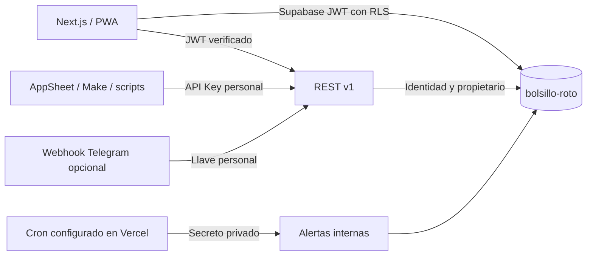

# Contexto de Bolsillo Roto

Aplicación personal para registrar rápidamente ingresos/gastos, conocer caja y anticipar cuotas. Usuario inicial: José; se admite más de un usuario mediante Supabase Auth y RLS. Moneda inicial COP, fecha de negocio America/Bogota. No conecta con bancos ni ejecuta pagos.

## Estado implementado

Next.js App Router, React, RHF/Zod, CSS responsive y tipografía Geist + Plus Jakarta Sans, lucide-react. Pantallas: resumen, movimientos, cuentas, tarjetas/simulador, presupuesto, préstamos, proyección, integraciones, dispositivos y avisos. `/demo` contiene datos ficticios locales, aislados de la base; `/` usa Supabase y empieza vacío hasta iniciar sesión y crear cuentas.

### Sistema Visual y Experiencia de Usuario (UI/UX)

- **Estética**: Dark Mode Modern Fintech con micro-interacciones fluidas y acabados glassmorphic sutiles.
- **Tipografía de alta ingeniería**: Adopción de `Geist` para cuerpo/métricas y `Plus Jakarta Sans` para titulares y marcas visuales; activación universal de cifras tabulares (`font-feature-settings: "tnum" 1`).
- **Paleta de contraste calibrada**: Fondo base `#090e17`, paneles `#111827`, realce positivo en `#5ee8ad` (Electric Mint) y alertas de fuga en `#ef9282` (Coral).
- **Animaciones y respuesta táctil**: Transiciones cubic-bezier con feedback táctil `:active` en botones, apertura fluida de modales con desenfoque de fondo y animación contextual para notificaciones tipo Toast.
- **Detalles completos**: Ver `docs/DISENO.md` y `DESIGN.md`.

Única base autorizada: Supabase **bolsillo-roto**, `kgergeimnxcyptffvmnp`, `us-east-1`. Se verificó vacía antes de aplicar las migraciones. Tablas: profiles, devices, accounts, transactions, amortizations, api_keys, loans, loan_payments, notifications y recurring_entries. `auth.users` es la identidad canónica; no se duplican contraseñas. `private.api_usage` cuenta consumo por llave.



API JWT usa el token del usuario, por lo que las políticas RLS siguen aplicándose. API Keys y cron necesitan `SUPABASE_SERVICE_ROLE_KEY` del lado servidor: verifican llave/propietario y nunca aceptan el propietario enviado por el cliente. Las funciones privilegiadas financieras están en `private`, usan `search_path` vacío, validación explícita de identidad y concesiones restringidas; wrappers públicos invoker ofrecen operaciones finitas.

## Sesiones

Roles de aplicación: `SUPERADMIN_EMAIL` (solo servidor) identifica el correo confirmado que puede consultar el directorio administrativo. Los demás usuarios son normales; ninguna API Key habilita administración. El rol no amplía el acceso RLS a finanzas ajenas. Configuración inicial solicitada: superadmin jockrlos210@gmail.com, usuario normal padilla99j@gmail.com. Ambos deben registrarse y confirmar su correo; no se crearon contraseñas ni usuarios automáticamente. Endpoints `/api/v1/me` y `/api/v1/admin/users`; guía de despliegue: DESPLIEGUE.md.

El cliente persiste y refresca sesión con Supabase. No se promete permanencia absoluta: expiraciones de configuración, cambios de contraseña, revocaciones, eliminación de almacenamiento y seguridad del proveedor pueden cerrar la sesión. Véase [Supabase sessions](https://supabase.com/docs/guides/auth/sessions).

La tabla de dispositivos identifica el `session_id` del JWT ya verificado. RLS de tablas financieras comprueba que no esté revocado. Revocar aplica a la app y a sus políticas de datos; no elimina necesariamente la sesión interna de `auth.sessions` ni invalida instantáneamente un JWT para otros servicios de Supabase. No se usa Storage en esta versión.

## Estructura

```text
src/
  app/
    layout.tsx, page.tsx, globals.css, manifest.ts
    demo/page.tsx
    api/v1/{accounts,transactions,gastos,ingresos,summary,keys,devices}/route.ts
    api/cron/alerts/route.ts
    api/telegram/route.ts
  components/{dashboard,loans,projection}.tsx
  lib/{finance,schemas,supabase,server,telegram}.ts
public/                 # Marca, iconos, worker y página offline
supabase/migrations/    # Esquema versionado
tests/                  # Matemática y parsing
docs/                   # Contexto canónico y contratos
```

## Pendiente de configuración o desarrollo

Credencial privada de servidor para integraciones/cron; variables y registro del webhook Telegram; despliegue Vercel. Email, Web Push, audio, widgets nativos, webhooks salientes, conciliación de cuotas y transferencias requieren desarrollo posterior. No se han creado proyectos ni bases paralelas. Estado detallado de requisitos: PRD.md. Comandos y configuración: README.md.
