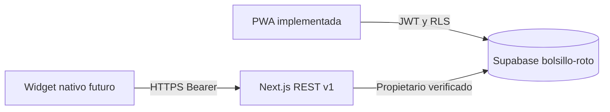

# PWA y arquitectura de widgets

## Implementado

Next.js sirve `app/manifest.ts` con nombre, iconos y accesos rápidos para registrar ingresos y gastos. El service worker conserva una página offline estática; nunca cachea respuestas financieras ni tokens. El acceso rápido abre el formulario. Requiere confirmar el gasto dentro de la app, conexión y una sesión válida.

La PWA instalada no puede, por sí sola, añadir widgets interactivos universales a iOS, Android y Windows. Instalarla requiere HTTPS, salvo en localhost. En iOS se instala desde Compartir → Añadir a pantalla de inicio; el soporte y los accesos rápidos varían por navegador.

## Contrato para extensiones nativas

- Datos: `GET /api/v1/summary` y `GET /api/v1/accounts`; mostrar fecha de actualización y ocultar saldos sensibles por defecto.
- Acciones: `POST /api/v1/gastos` con `Idempotency-Key` aleatoria y persistida hasta confirmar la respuesta. No mutar datos desde GET ni desde una URL de shortcut.
- Secretos: Keychain en iOS, Keystore en Android, almacenamiento protegido del sistema en escritorio. No incrustar API Keys en URLs ni bundles públicos. El widget debe permitir revocación y ocultar saldos con el dispositivo bloqueado.
- Es preferible introducir llaves con permisos mínimos antes de distribuir un widget públicamente; las llaves actuales tienen acceso a toda la API financiera del propietario.

## Plataformas

**iOS:** aplicación contenedora Swift/Capacitor y extensión WidgetKit. App Groups para compartir snapshots; App Intents para acciones. El sistema controla cuándo refresca la línea de tiempo: no prometer datos en tiempo real. [WidgetKit](https://developer.apple.com/documentation/widgetkit).

**Android:** contenedor y AppWidget/Glance. WorkManager para refresco, acciones con PendingIntent y validación en servidor. La PWA sola no es un AppWidget. [App widgets](https://developer.android.com/develop/ui/views/appwidgets/overview).

**PC:** comenzar con la PWA y accesos rápidos. Un widget del panel de Windows requiere un proveedor compatible y su empaquetado; el dashboard web se puede reutilizar como interfaz pero no registra ese proveedor.

## Push pendiente

Para Web Push hace falta guardar suscripciones bajo RLS, obtener permiso desde una acción explícita, configurar VAPID y un worker con `push`/`notificationclick`, y enviar desde un backend programado. El manifest y el service worker actuales no implican que Push esté habilitado. Documentación: [PWA en Next.js](https://nextjs.org/docs/app/guides/progressive-web-apps).
